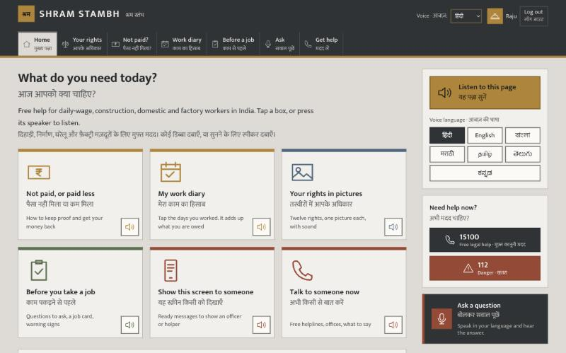
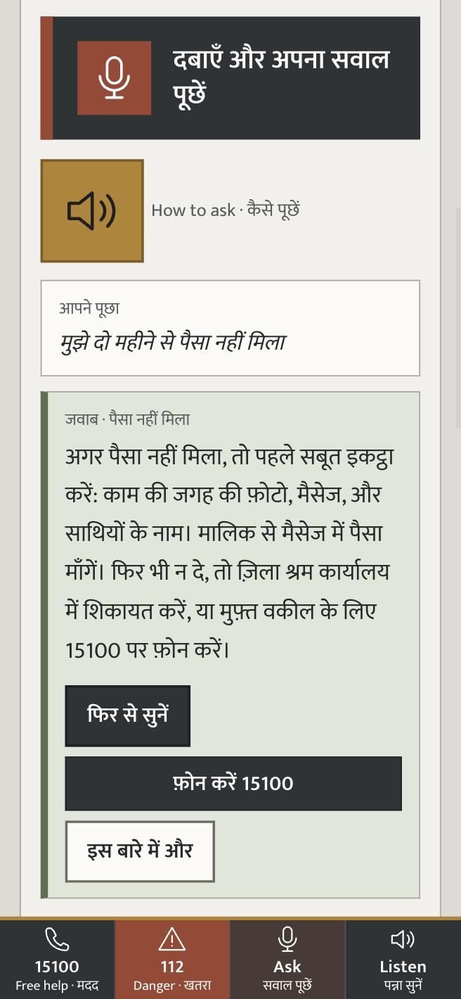
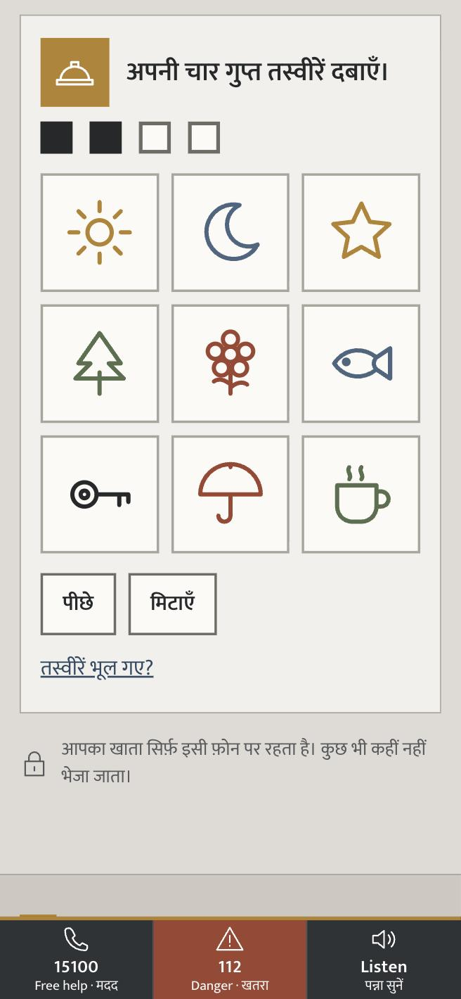
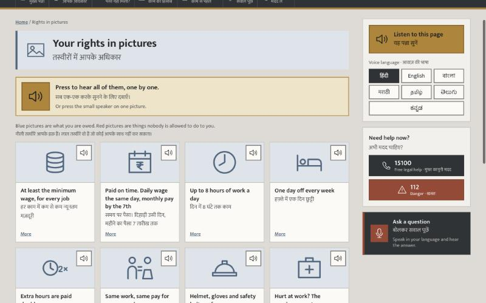
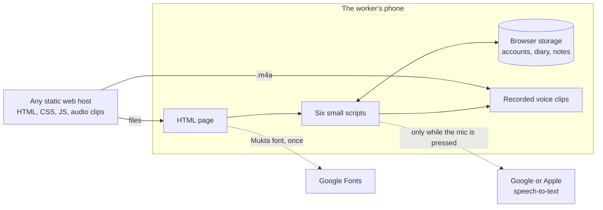
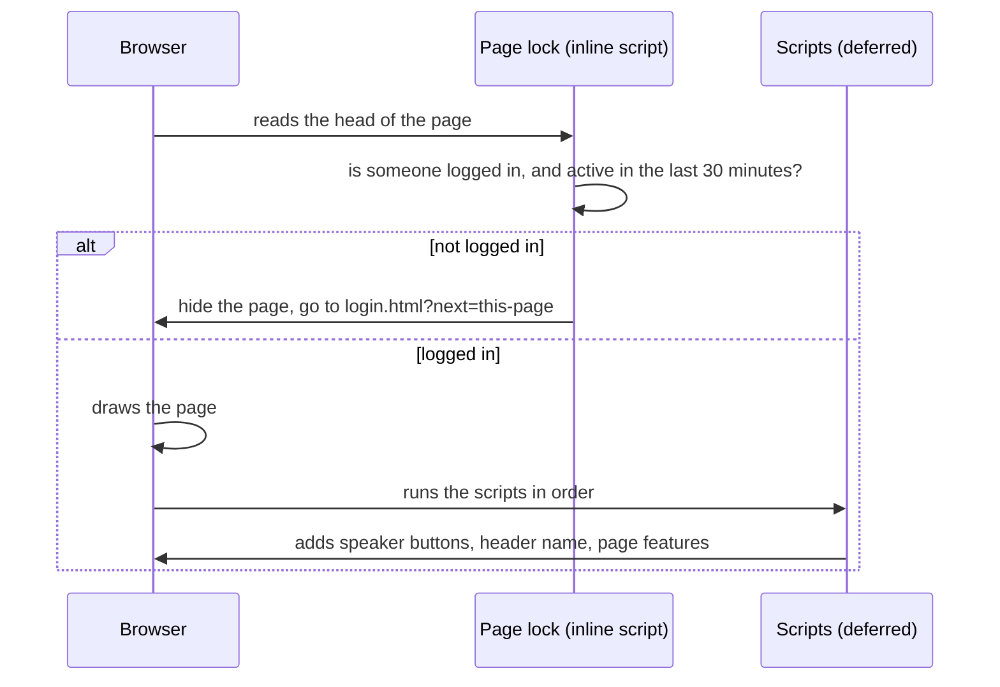
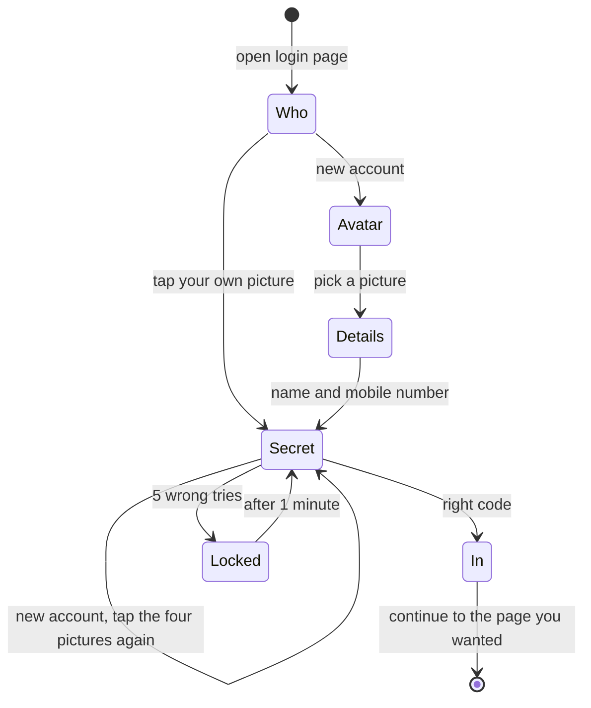
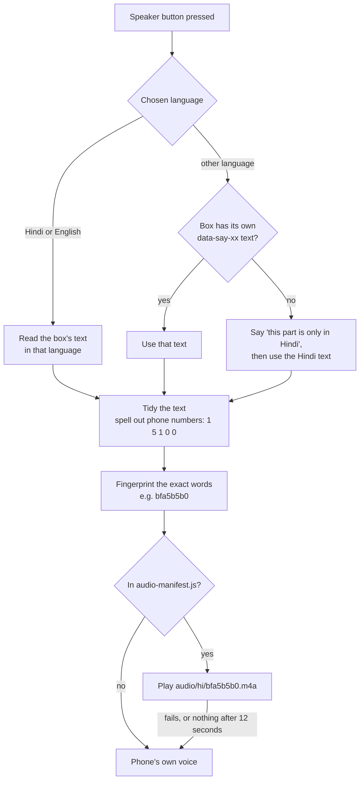
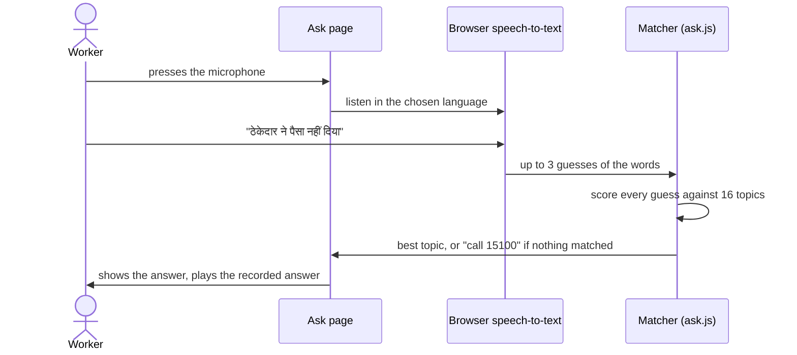

# SHRAM STAMBH · श्रम स्तंभ

**A free website that helps India's daily-wage, construction, domestic and factory workers get paid fairly and know their rights, even if they cannot read.**

*Shram Stambh* means "pillar of labour".



---

## Contents

- [The problem](#the-problem)
- [Who it is for](#who-it-is-for)
- [What the site does](#what-the-site-does)
- [Screenshots](#screenshots)
- [Languages](#languages)
- [Run it on your computer](#run-it-on-your-computer)
  - [Run it on localhost](#run-it-on-localhost-needed-for-the-microphone)
- [Architecture](#architecture)
  - [The big picture](#the-big-picture)
  - [How a page loads](#how-a-page-loads)
  - [Login and the page lock](#login-and-the-page-lock)
  - [The voice](#the-voice)
  - [Asking a question](#asking-a-question)
  - [Saving the diary and notebook](#saving-the-diary-and-notebook)
  - [How the scripts talk to each other](#how-the-scripts-talk-to-each-other)
- [Reference](#reference)
  - [Project structure](#project-structure)
  - [The stylesheet](#the-stylesheet)
  - [The data files](#the-data-files)
  - [What is saved in the browser](#what-is-saved-in-the-browser)
  - [Browser support](#browser-support)
- [Changing the site](#changing-the-site)
- [Putting it online](#putting-it-online)
- [Accessibility](#accessibility)
- [Privacy and security](#privacy-and-security)
- [Known limits](#known-limits)
- [Before using it with real workers](#before-using-it-with-real-workers)

---

## The problem

Millions of workers in India face the same four problems:

| Problem | What happens |
|---|---|
| **Wage theft** | Workers are paid late, paid less than agreed, or not paid at all, and have no proof of the days they worked. |
| **Not knowing their rights** | Few workers know the minimum wage, pay dates, overtime rules, or that bonded labour is a crime. |
| **No way to check an employer** | There is no easy way to find out whether a contractor pays properly before agreeing to the job. |
| **Language and reading barriers** | Most help is in English, written down, and assumes the reader can read. |

## Who it is for

- **Workers**, including people who have never learnt to read. Everything can be heard, every topic has a picture and a colour, and the login uses pictures instead of a password.
- **Helpers**, such as NGO staff, union volunteers and family members who sit with a worker and go through the site together.
- **Shared phones.** One cheap Android phone is often used by a whole family, so each person gets their own private account, diary and notes on the same phone.

## What the site does

### For people who cannot read
- **Every box can be read aloud.** Each box has a speaker button. A "Listen" button in the bottom bar reads the whole page, box by box.
- **Seven spoken languages.** Every page is written in English and Hindi, and the voice speaks seven Indian languages.
- **Pictures and colours.** Every topic has its own picture and colour: yellow for money, blue for rights, green for a new job, red for help.
- **Picture login.** There is no password. People tap their own picture, then four secret pictures.
- **Call buttons everywhere.** Free legal help (15100) and emergency (112) are one tap away on every page, even before logging in.
- **An icon on the home screen.** "Add to Home screen" in the phone's browser puts the logo on the home screen, so the site opens with one tap and no address to type.

### Getting paid
- **Not paid?** ([wages.html](wages.html)) Six steps to recover unpaid wages, a message template to send the employer as written proof, and a printable work log.
- **Work diary.** ([diary.html](diary.html)) Tap the days you worked, add money as you receive it, and the page works out what you are still owed. It can read the total aloud, and **send the month on WhatsApp**: the dates worked, every payment and the amount still owed, in Hindi and English, as written proof for the employer or a helper.

### Knowing your rights
- **Your rights.** ([rights.html](rights.html)) Rights for every worker, plus sections for construction, domestic, factory and migrant workers.
- **Rights in pictures.** ([pictures.html](pictures.html)) Twelve rights, one picture each, with sound.

### Before taking a job
- **Before a job.** ([before-job.html](before-job.html)) Questions to ask, a **job card** for both sides to sign, and **warning signs** of bonded labour.
- **Contractor notebook.** On the same page: save notes on whether a contractor paid properly, search them, and send a warning to a WhatsApp group in one tap.

### Getting help
- **Ask a question by voice.** ([ask.html](ask.html)) Press the microphone, ask in your own language, and hear the answer. It covers 16 common problems, from unpaid wages to injuries and harassment. People without a microphone can tap a picture question or type instead.
- **Show this screen.** ([show.html](show.html)) Ready-made messages fill the whole screen, such as "I cannot read, please read this to me", so a worker can hand the phone to an officer or doctor.
- **Helplines.** ([help.html](help.html)) Free numbers, which office to visit for which problem, and what to say on the phone.

## Screenshots

| Ask a question (phone) | Picture login (phone) |
|---|---|
|  |  |



## Languages

| Language | Written on the pages | Spoken | Recorded clips |
|---|---|---|---|
| Hindi · हिंदी | ✓ every page | ✓ everything | 129 |
| English | ✓ every page | ✓ everything | 140 |
| Bengali · বাংলা | – | home page, rights in pictures, Ask, login | 65 |
| Marathi · मराठी | – | home page, rights in pictures, Ask, login | 65 |
| Tamil · தமிழ் | – | home page, rights in pictures, Ask, login | 65 |
| Telugu · తెలుగు | – | home page, rights in pictures, Ask, login | 65 |
| Kannada · ಕನ್ನಡ | – | home page, rights in pictures, Ask, login | 65 |

Where a box has no translation in the chosen language, the voice first says so in that language ("this part is only in Hindi and English"), then reads the Hindi.

## Run it on your computer

There is nothing to install and nothing to build. The site is just HTML, CSS and JavaScript files.

**Double-click `index.html`** to open it in Chrome, Edge or Safari. Make an account with any name and a 10-digit mobile number starting with 6, 7, 8 or 9. The account is saved only in that browser.

Opened this way, everything works except asking questions by microphone. Browsers only allow the microphone on a web address (`https://` or `http://localhost`).

### Run it on localhost (needed for the microphone)

Use either of these. Neither adds anything to the project.

**On a Mac, with nothing to install.** macOS comes with Ruby, which has a small web server built in. Open Terminal in the project folder and run:

```bash
ruby -rwebrick -e 'm = WEBrick::HTTPUtils::DefaultMimeTypes.merge("m4a" => "audio/mp4"); s = WEBrick::HTTPServer.new(Port: 8123, DocumentRoot: ".", MimeTypes: m); trap("INT") { s.shutdown }; s.start'
```

Then open **http://localhost:8123** in Chrome or Safari. To stop it, press `Ctrl + C` in Terminal. (The `m4a` part tells browsers the voice clips are audio. Without it Ruby sends them as unknown files, which Safari can refuse to play.)

**On any computer, with VS Code.** Install the free "Live Server" extension, open the project folder, right-click `index.html` and choose **Open with Live Server**. It opens at **http://localhost:5500**.

Either way, the site opens on the login page. Make an account to see the rest. Local servers don't use `404.html`, so a mistyped address shows the server's own "not found" page instead.

## Architecture

### The big picture

SHRAM STAMBH is a **static website**: every page is a ready-made HTML file, and all the logic runs in the visitor's browser. There is no backend, no database, no framework and no build step.



Three choices shape everything else:

| Choice | Why |
|---|---|
| **No server** | Nothing to run, pay for or keep secure. It can be hosted for free. Workers' details can't leak from a server because there isn't one. |
| **Recorded voice instead of the phone's voice** | Many cheap Android phones have no Hindi, Tamil or Telugu voice installed, so their built-in speech would stay silent. A recording plays on any phone. |
| **Plain JavaScript, no libraries** | Small files that load fast on slow mobile data. Nothing to update or patch. |

### How a page loads

Every page is a complete HTML file with the same shell: the dark top strip, the header and menu, the page's own content, a sidebar on wide screens, the footer and the bottom bar with four big buttons.



1. **The page lock runs first.** A tiny inline script at the very top of `<head>` checks `sessionStorage` for a logged-in account. If there isn't one, it hides the page before anything is drawn and jumps to the login page. It checks again if the Back button shows a cached copy of the page, so logging out and pressing Back reveals nothing.
2. **The scripts load in a fixed order**, all with `defer`, so they run after the HTML is ready:

   | Order | File | What it sets up |
   |---|---|---|
   | 1 | `audio-manifest.js` | `SS_AUDIO`: the list of recorded clips |
   | 2 | `lang-data.js` | `SS_LANG`: the seven languages and shared spoken lines |
   | 3 | `account-data.js` | `SS_ACCOUNT`: login text, profile pictures and secret pictures |
   | 4 | `speak.js` | The voice. Adds a speaker button to every box and wires up the language picker and Listen button |
   | 5 | `account.js` | Accounts. Shows the logged-in name in the header and handles logging out |
   | 6 | `site.js` | Print buttons and the contractor notebook |
   | 7 | page's own script | `ask-data.js` + `ask.js` on the Ask page, `login.js` on the login page, `diary.js` on the diary page |

3. **Cache busting.** Every CSS and JS link ends in `?v=40`. Raising the number makes phones fetch the new file instead of an old cached copy.
4. **Without JavaScript**, the page lock can't run, so a CSS rule keeps the content hidden and a message with the 15100 and 112 call buttons shows instead.

### Login and the page lock

Workers often share one phone, so each person has their own account. Accounts live only on that phone ([account.js](account.js) and [login.js](login.js)).



- **One step at a time.** The login screen shows a single step, and speaks its instruction in the chosen language. The name can be spoken into the microphone instead of typed.
- **The secret code is never stored.** Only a fingerprint is saved: SHA-256 of a random salt plus the four picture ids. Logging in recomputes it and compares. Secret taps are never spoken aloud, so someone nearby can't hear the code.
- **Checks.** A name needs at least two letters in any script. A mobile number must be a valid 10-digit Indian number, and can't be used by two accounts.
- **Staying logged in.** The logged-in account is kept in `sessionStorage`, so closing the browser logs out. Every tap, key press or scroll updates a timestamp, and after 30 minutes without use the account logs out by itself.
- **Forgot your pictures?** Nobody can reset the code, because there is no server. Instead, the account and its diary can be removed after a spoken warning and a second confirmation tap.

### The voice

[speak.js](speak.js) turns any box on the page into speech in the chosen language.



- **Finding the words.** Each page writes English and Hindi side by side, with Hindi marked `lang="hi"`. `gather()` walks through a box and collects only the text in the wanted language, skipping buttons, icons and hidden parts.
- **Matching a recording.** The clip's file name is a short fingerprint (an FNV-1a hash) of its exact words. If even one letter changes, the fingerprint changes and the phone's own voice is used until the line is re-recorded.
- **Where the clips came from.** They were made on a Mac with its built-in voices (`say` with Lekha, Tara, Piya, Vani, Geeta and Soumya), then compressed to small AAC files with `afconvert`, about 4 KB per second. A phone only downloads a clip when it is played.
- **Behaving well on real phones.** A shaky double tap counts as one tap. Pressing the same button again stops it. Starting a new box stops the old one. If a phone blocks autoplay, a message asks for one more tap. A watchdog resets the phone's voice if it gets stuck.
- **Choosing a language** saves it in `localStorage`, says a confirmation in the new language, and tells the rest of the page with an `ss-lang` event.

### Asking a question

[ask.js](ask.js) answers 16 common problems without AI. The browser turns speech into text, and the site matches that text against keywords.



How the score works ([ask-data.js](ask-data.js) holds the words):

1. The text is cleaned: lower case, punctuation removed, and small Hindi spelling differences such as nukta dots evened out.
2. Each topic scores **2 points** for every strong keyword (such as "ठेकेदार", "காயம்" or "PF") and **1 point** for every weak one (such as "card").
3. It gets **3 more points** when words from two groups appear together. For example a money word plus a "not" word means unpaid wages ("पैसा नहीं मिला"). The groups are `MONEY`, `NEG`, `WHEN`, `HOWMUCH`, `CONTRACTOR` and `DOMESTIC`, each with words in all seven languages and romanised Hindi.
4. The highest score wins. Ties go to the more urgent topic, so forced labour beats a general answer.
5. Without a microphone, the same answers come from 16 picture buttons or a text box.

### Saving the diary and notebook

Everything a person saves stays in their own browser's `localStorage`. Each logged-in person's data is stored under their own key (`name:accountid`), so two people sharing a phone never see each other's diary or notes.

| What | Stored as |
|---|---|
| Work diary ([diary.js](diary.js)) | Daily rate, employer details, the days marked as worked, and each payment received. The page adds these up to show what is still owed. "Send on WhatsApp" turns the month into a plain message and opens WhatsApp with it; nothing is sent until the worker presses send there. |
| Contractor notebook ([site.js](site.js)) | A list of contractors with a verdict: paid fully, paid late or less, or did not pay. Each can be shared to WhatsApp as a ready-made message. |

### How the scripts talk to each other

The scripts don't import each other. They share a few named objects on `window` and two events:

| Shared by | Name | Used for |
|---|---|---|
| speak.js | `ssSpeak()`, `ssStop()`, `ssLang()`, `ssSetLang()`, `ssToast()` | Any script can speak a line, stop speaking, read or change the language, or show a short message |
| speak.js | `ssDebug` | Testing: lists every sentence a page can speak and its clip |
| account.js | `ssAccount` | Create, check, log in, log out and remove accounts; `key()` gives a per-person storage name |
| login.js | `ssLogin` | The login screen |
| speak.js | `ss-lang` event | Fired when the language changes. The Ask page, the login screen and the header relabel themselves |
| account.js | `ss-account` event | Fired when someone logs in or out. Nothing listens for it yet; it is there for future features |

## Reference

### Project structure

```
SHRAM-STAMBH/
├── index.html          Home page: listen button, language buttons, picture tiles
├── rights.html         Your rights: every worker, then construction, domestic, factory, migrant
├── pictures.html       Rights in pictures: twelve picture cards with sound
├── wages.html          Not paid?: six steps, message template, printable work log
├── diary.html          Work diary: tap days worked, add payments, see what is owed
├── before-job.html     Questions to ask, job card, warning signs, contractor notebook
├── show.html           Show this screen: full-screen messages for an officer or doctor
├── ask.html            Ask a question by voice, picture buttons or typing
├── help.html           Helplines, which office for which problem, what to say
├── login.html          Picture login
├── 404.html            Page not found, with home link and 15100 call button
│
├── style.css           All styling, in 17 numbered sections (about 1,300 lines)
├── speak.js            The voice: finds text, plays recordings, falls back to phone voice
├── ask.js              Voice questions: listens, scores against 16 topics, answers
├── account.js          Accounts on this phone, idle logout, lockout, header name
├── login.js            The login screen, one step at a time
├── diary.js            The work diary
├── site.js             Print buttons and the contractor notebook
│
├── audio-manifest.js   List of the 594 recorded clips
├── lang-data.js        Seven languages and shared spoken lines
├── ask-data.js         Ask topics, keywords, word groups and answers
├── account-data.js     Login text, 8 profile pictures, 9 secret pictures
│
├── audio/              594 voice clips (.m4a), one folder per language: hi en bn mr ta te kn
├── favicon.svg         The logo (fist, pillar and gear) on a dark tile
├── icons/              Home-screen icons: 192px, 512px, maskable 512px, iPhone 180px
├── manifest.json       Name, start page, colours and icons for "Add to Home screen"
│
├── _headers            Caching and safety headers, read by Netlify and Cloudflare Pages
├── .nojekyll           Tells GitHub Pages to serve the files without processing them
├── .github/            Issue forms: wrong facts, translations, bugs
├── CHANGELOG.md        What changed in each version
├── CONTRIBUTING.md     Ground rules, editing text, recording new voice lines
└── docs/screenshots/   Images used in this README
```

### The stylesheet

[style.css](style.css) starts with a table of contents. Each rule appears once, with its final value, and everything that changes on smaller screens is together in section 16.

| # | Section | # | Section |
|---|---|---|---|
| 1 | Colours and fonts (design tokens) | 10 | Rights in pictures, Show this screen |
| 2 | Base: page, text, links, headings | 11 | Work diary and buttons |
| 3 | Show / hide helpers | 12 | Contractor notebook |
| 4 | Header: logo, voice picker, account button, menu | 13 | Language buttons and the Ask page |
| 5 | Page layout: main column and sidebar | 14 | Login page |
| 6 | Common boxes: panels, headings, notes, tables | 15 | Sidebar, bottom bar, footer, small messages |
| 7 | Voice: speaker buttons and listen boxes | 16 | Screen sizes, wide screens first, then tablets and phones |
| 8 | Home page: picture tiles and ask banner | 17 | Printing, reduced motion, JavaScript turned off |
| 9 | Call buttons and help boxes | | |

**Colours.** The page is a calm grey. Each topic has one fixed colour, used for its home-page tile and the coloured left edge of its boxes, so a person who can't read can find things by colour: ochre-yellow `t-wages`, blue `t-rights`, green `t-job` and red `t-help`. The colours are set once as tokens in section 1.

**Screen sizes.** Above 1100px wide there is a sticky sidebar with "Listen to this page", the language buttons, the 15100 and 112 call buttons, and Ask. Below that the sidebar folds away and the four-button bottom bar does the same job. The layout was checked at widths from 320px to 1920px.

### The data files

Each one sets a single object on `window`. They are plain JavaScript with one entry per line, so they can be edited by hand.

| File | Object | What is in it |
|---|---|---|
| [audio-manifest.js](audio-manifest.js) | `SS_AUDIO` | `"language:fingerprint": 1` for every recorded clip |
| [lang-data.js](lang-data.js) | `SS_LANG` | `langs` (code, name, speech-recognition code), and lines spoken on every page, such as the language confirmation |
| [ask-data.js](ask-data.js) | `SS_ASK` | `topics` (keywords, weak words, word combinations, answer in seven languages, call buttons, link), `concepts` (the word groups), `order` (picture buttons) and `matchOrder` (tie-breaking) |
| [account-data.js](account-data.js) | `SS_ACCOUNT` | `text` (every login line in seven languages), `avatars` and `secrets` (the pictures as inline SVG) |

### What is saved in the browser

| Key | Where | What it holds |
|---|---|---|
| `ss-profiles` | localStorage | Every account on this phone: id, picture, name, mobile, salt, fingerprint of the secret code |
| `ss-locks` | localStorage | Wrong-try counters for the one-minute lockout |
| `ss-voice` | localStorage | The chosen language |
| `ss-session` | sessionStorage | Which account is logged in. Gone when the browser closes |
| `ss-last` | sessionStorage | Time of the last tap, for the 30-minute idle logout |
| `shramik-diary-v1:<account>` | localStorage | That person's work diary |
| `shramik-contractors-v1:<account>` | localStorage | That person's contractor notebook |

Nothing else is stored, and none of it is sent anywhere.

### Browser support

| Feature | Chrome / Edge | Safari | Firefox |
|---|---|---|---|
| Pages, login, diary, notebook | ✓ | ✓ | ✓ |
| Recorded voice | ✓ | ✓ | ✓ |
| Phone's own voice (backup) | ✓ if the device has a voice for that language | ✓ if the device has a voice for that language | ✓ if the device has a voice for that language |
| Asking by microphone | ✓ on HTTPS | ✓ on HTTPS | – picture buttons and typing instead |

## Changing the site

Edit the files directly. There is no build step.

- **Page text** (English and Hindi) is in each `.html` file.
- **Spoken text in the other five languages** is in `data-say-bn`, `data-say-mr`, `data-say-ta`, `data-say-te` and `data-say-kn` attributes on the boxes, and in the `*-data.js` files.
- **The header, menu, footer and bottom bar** are repeated in every page. Change all eleven pages the same way.
- **New or changed spoken sentences** have no recording yet, because each clip matches its exact words. The phone's own voice reads them instead until they are recorded. [CONTRIBUTING.md](CONTRIBUTING.md#recording-the-voice-for-a-new-or-changed-sentence) has the steps to record them on a Mac.
- **After changing `style.css` or a `.js` file**, raise the `?v=40` number on the links in every page, so phones load the new file instead of an old copy.

### Checking after a change

1. Log out, then open any page. It should go straight to the login page.
2. Make an account and log in. You should come back to the page you opened.
3. Open every page from the menu. Nothing should be cut off, and there should be no sideways scrolling on a phone-sized window.
4. Press a few speaker buttons in two or three languages. Each should speak once, not twice.
5. Open the browser console (`F12`). There should be no red errors.
6. To check that every spoken line still has a recording, run this in the console on each page. It should print `0`:

   ```js
   ssDebug.collect().filter(p => !ssDebug.audioUrl(p)).length
   ```

7. Open print preview (`Ctrl + P`, or `Cmd + P` on a Mac) on the wages page and the diary. Only the content should show: no menus, speaker buttons or print buttons.
8. In the diary, mark a day and press **Send this month on WhatsApp**. The message should match the totals on screen.

## Putting it online

Upload everything except the `docs/` and `.github/` folders to any static web host, such as GitHub Pages, Netlify or Cloudflare Pages.

- **Use HTTPS.** The microphone only works on secure addresses, and phones only offer "Add to Home screen" as an app on HTTPS.
- **Set caching.** Pages, scripts and styles should be re-checked on every visit (`Cache-Control: no-cache`). The `audio/` folder can be cached for a long time, because a clip's name changes whenever its words change.
  - **Netlify and Cloudflare Pages** read [`_headers`](_headers), which already does this for `audio/` and adds standard safety headers. Their default for other files is to re-check each visit.
  - **GitHub Pages** can't set headers. [`.nojekyll`](.nojekyll) makes it serve the files exactly as they are.
- `404.html` is used automatically by most hosts for wrong addresses.

## Accessibility

- **Readable text.** Contrast meets WCAG AA: at least 4.5 : 1, or 3 : 1 for large text.
- **Easy to tap.** Every button is at least about 44 pixels tall.
- **Works with assistive tools.** Every button and form field has a name screen readers can announce, and headings are in order.
- **Fits every screen.** It was tested at eight widths, from 320px phones to 1920px monitors, with no sideways scrolling.
- **Prints cleanly.** The work log and job card print in black and white, without the menus.
- **JavaScript turned off.** Content stays hidden behind the login, and a message with the 15100 and 112 call buttons shows instead.

## Privacy and security

- No tracking and no analytics.
- Names, mobile numbers, the diary and notes never leave the phone.
- When the microphone is used, the browser sends the voice to Google (Chrome) or Apple (Safari) to turn it into text. The site says this on the Ask page.
- The only other thing downloaded from outside is the Mukta font, from Google Fonts.
- The site never asks for Aadhaar.
- **How strong the login is.** Four secret pictures out of nine give 6,561 possible codes, and five wrong tries lock the account for a minute. That stops family members or co-workers on a shared phone. It does not stop someone with the phone and technical skill, because a website with no server keeps its data in the browser.

## Known limits

- **Accounts stay on one phone.** They can't be moved to a new phone or reset. That's by design, but tell users about it.
- **Changing text uses the backup voice.** Diary totals and notebook entries use the phone's own voice, which is silent on some phones that have no Hindi voice installed.
- **Marathi voice.** Marathi is read by the Hindi voice, because macOS has no Marathi voice.
- **Microphone.** Voice questions need Chrome, Edge or Safari and an internet connection. Firefox doesn't support speech recognition, so it gets the picture questions and typing instead.
- **Contractor notes are private.** They are only on one phone. Sharing between workers happens through WhatsApp, not through the site.

## Before using it with real workers

- **Translations.** Have a native speaker check each language in the pages and the `*-data.js` files. The Bengali, Marathi, Tamil, Telugu and Kannada text has not been checked yet.
- **Facts.** Check the helpline numbers and legal facts against current government sources. Minimum wages change often and differ by state.
- **Voice input on phones.** Test the microphone on real Android phones and iPhones once the site is on HTTPS.

---

*This site gives general information, not legal advice. For your own case, call free legal aid on **15100** or visit your district labour office.*

What changed in each version is in [CHANGELOG.md](CHANGELOG.md). To help, see [CONTRIBUTING.md](CONTRIBUTING.md). To report a wrong fact, a translation problem or a bug, [open an issue](https://github.com/ridhimasharma02/SHRAM-STAMBH/issues/new/choose).

No licence has been chosen yet, so by default all rights are reserved by the author.
