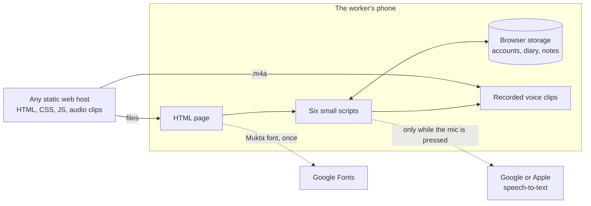
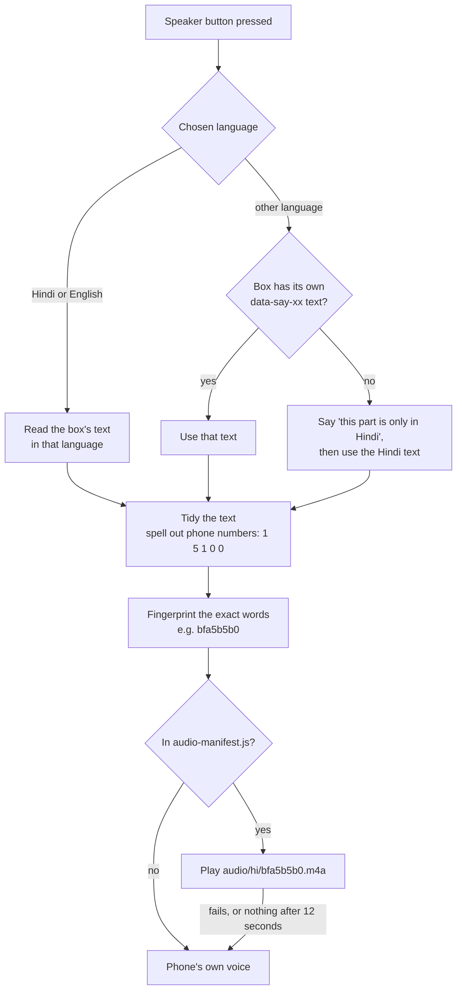

# SHRAM STAMBH · श्रम स्तंभ

**A free website that helps India's daily-wage, construction, domestic and factory workers get paid fairly and know their rights, even if they cannot read.**

*Shram Stambh* means "pillar of labour".


## Contents

- [The problem](#the-problem)
- [What the site does](#what-the-site-does)
- [Run it on your computer](#run-it-on-your-computer)
- [How it works](#how-it-works)
- [Project structure](#project-structure)
- [Putting it online](#putting-it-online)
- [Accessibility, privacy and limits](#accessibility-privacy-and-limits)

## The problem

| Problem | What happens |
|---|---|
| **Wage theft** | Workers are paid late, paid less than agreed, or not paid at all, and have no proof of the days they worked. |
| **Not knowing their rights** | Few workers know the minimum wage, pay dates, overtime rules, or that bonded labour is a crime. |
| **No way to check an employer** | There is no easy way to find out whether a contractor pays properly before agreeing to the job. |
| **Language and reading barriers** | Most help is in English, written down, and assumes the reader can read. |

The site is built for workers who may never have learnt to read, for the NGO staff and union volunteers who help them, and for cheap phones shared by a whole family.

## What the site does

**For people who cannot read**
- **Every box can be read aloud** from real recordings, in Hindi and English everywhere and five more languages on the key pages. A "Listen" button reads the whole page.
- **Pictures and colours** for every topic: yellow for money, blue for rights, green for a new job, red for help.
- **Picture login** with no password: tap your own picture, then four secret pictures.
- **Call buttons** for free legal help (15100) and emergency (112) on every page, even before logging in.
- **Home-screen icon**, so the site opens with one tap and no address to type.

**The pages**

| Page | What it does |
|---|---|
| [Not paid?](wages.html) | Six steps to recover unpaid wages, a message to send the employer as proof, and a printable work log |
| [Work diary](diary.html) | Tap the days worked, add money received, and see what is still owed. Hear the total, or **send the month on WhatsApp** as written proof |
| [Your rights](rights.html) | Rights for every worker, plus construction, domestic, factory and migrant workers |
| [Rights in pictures](pictures.html) | Twelve rights, one picture each, with sound |
| [Before a job](before-job.html) | Questions to ask, a job card for both sides to sign, warning signs of bonded labour, and a **contractor notebook** to share warnings on WhatsApp |
| [Ask a question](ask.html) | Ask by voice in your own language and hear the answer. Covers 16 common problems. Picture buttons and typing work too |
| [Show this screen](show.html) | Full-screen messages such as "I cannot read, please read this to me", to hand the phone to an officer or doctor |
| [Get help](help.html) | Free helplines, which office to visit, and what to say on the phone |

| Ask a question (phone) | Picture login (phone) |
|---|---|
|  |  |


**Languages.** Every page is written in English and Hindi, and both are spoken everywhere. Bengali, Marathi, Tamil, Telugu and Kannada are spoken on the home page, Rights in pictures, Ask and the login. Elsewhere the voice says, in that language, that the part is only in Hindi, then reads the Hindi.

## Run it on your computer

There is nothing to install and nothing to build. **Double-click `index.html`** to open it in Chrome, Edge or Safari, then make an account with any name and a 10-digit mobile number starting with 6–9. The account is saved only in that browser.

Everything works this way except the microphone, which browsers only allow on `https://` or `http://localhost`. To run it on localhost:

- **On a Mac, with nothing to install,** open Terminal in the project folder and run this, then open **http://localhost:8123**. Press `Ctrl + C` to stop it.

  ```bash
  ruby -rwebrick -e 'm = WEBrick::HTTPUtils::DefaultMimeTypes.merge("m4a" => "audio/mp4"); s = WEBrick::HTTPServer.new(Port: 8123, DocumentRoot: ".", MimeTypes: m); trap("INT") { s.shutdown }; s.start'
  ```

  It uses the Ruby that comes with macOS. The `m4a` part makes it send the voice clips as audio, which Safari needs.
- **On any computer with VS Code,** install the "Live Server" extension, right-click `index.html` and choose **Open with Live Server**. It opens at **http://localhost:5500**.

## How it works

SHRAM STAMBH is a **static website**. Every page is a ready-made HTML file and all the logic runs in the visitor's browser: no backend, no database, no framework and no build step.



| Choice | Why |
|---|---|
| **No server** | Nothing to run, pay for or keep secure, and workers' details can't leak from a server that doesn't exist. |
| **Recorded voice** | Many cheap Android phones have no Hindi, Tamil or Telugu voice installed, so the phone's own speech would stay silent. A recording plays on any phone. |
| **Plain JavaScript** | Small files that load fast on slow mobile data, with no libraries to update. |

### The voice

[speak.js](speak.js) adds a speaker button to every box and turns the box into speech in the chosen language.



Each clip is named after a fingerprint of its exact words, so a sentence changed by even one letter is read by the phone's own voice until it is re-recorded. The clips were made with the Mac's built-in voices (Lekha, Tara, Piya, Vani, Geeta and Soumya) and are about 4 KB per second; a phone downloads one only when it is played.

### Login and the page lock

- **Every page is locked.** A tiny script at the top of each page checks for a logged-in account before anything is drawn, and sends visitors without one to the login page. It checks again when the Back button shows a cached page.
- **One step at a time.** The login screen ([login.js](login.js)) shows a single step and speaks its instruction. The name can be spoken instead of typed.
- **The secret code is never stored**, only a salted SHA-256 fingerprint of it ([account.js](account.js)). Five wrong tries lock the account for a minute, and it logs out by itself after 30 minutes unused.

### Asking a question

[ask.js](ask.js) answers without AI. The browser turns speech into text, and the site scores up to three guesses of the words against 16 topics ([ask-data.js](ask-data.js)):

- **2 points** for each strong keyword, such as "ठेकेदार" or "PF", and **1 point** for each weak one.
- **3 more points** when words from two groups appear together, such as a money word plus a "not" word: "पैसा नहीं मिला" means unpaid wages. The word groups cover all seven languages and romanised Hindi.
- The highest score wins, ties go to the more urgent topic, and if nothing matches the answer is "call 15100".

### What is saved in the browser

Each person's data is stored under their own account id, so people sharing a phone never see each other's diary or notes. None of it is sent anywhere.

| Key | Where | What it holds |
|---|---|---|
| `ss-profiles` | localStorage | Every account on this phone: picture, name, mobile, salt, fingerprint of the secret code |
| `ss-locks` | localStorage | Wrong-try counters for the lockout |
| `ss-voice` | localStorage | The chosen language |
| `ss-session`, `ss-last` | sessionStorage | Who is logged in, and the time of the last tap. Gone when the browser closes |
| `shramik-diary-v1:<account>` | localStorage | That person's work diary |
| `shramik-contractors-v1:<account>` | localStorage | That person's contractor notebook |

## Project structure

```
SHRAM-STAMBH/
├── index.html, rights.html, pictures.html, wages.html, diary.html,
│   before-job.html, show.html, ask.html, help.html, login.html, 404.html
│
├── style.css           All styling, in 17 numbered sections (contents at the top)
├── speak.js            The voice: finds text, plays recordings, falls back to phone voice
├── ask.js              Voice questions: listens, scores against 16 topics, answers
├── account.js          Accounts on this phone, idle logout, lockout, header name
├── login.js            The login screen, one step at a time
├── diary.js            The work diary
├── site.js             Print buttons and the contractor notebook
│
├── audio-manifest.js   List of the 594 recorded clips
├── lang-data.js        Seven languages and shared spoken lines
├── ask-data.js         Ask topics, keywords, word groups and answers
├── account-data.js     Login text, 8 profile pictures, 9 secret pictures
├── audio/              The voice clips (.m4a), one folder per language
│
├── favicon.svg, icons/, manifest.json    Logo, home-screen icons and app details
├── _headers, .nojekyll                   Settings for Netlify, Cloudflare Pages, GitHub Pages
├── CHANGELOG.md        What changed in each version
└── CONTRIBUTING.md     How to edit text, record new voice lines and test a change
```

Edit the files directly; there is no build step. [CONTRIBUTING.md](CONTRIBUTING.md) explains where each kind of text lives, how to record a new voice line on a Mac, and the checks to run after a change.

## Putting it online

Upload everything except the `docs/` and `.github/` folders to any static web host, such as GitHub Pages, Netlify or Cloudflare Pages.

- **Use HTTPS.** The microphone and "Add to Home screen" need it.
- **Caching.** Pages, scripts and styles should be re-checked on every visit, while `audio/` can be cached for a long time. Netlify and Cloudflare Pages read [`_headers`](_headers), which sets this up. GitHub Pages can't set headers, but [`.nojekyll`](.nojekyll) makes it serve the files as they are.
- **Wrong addresses** show `404.html` on most hosts. Its links start at the site's root (`/style.css`), because it can be shown at any address, so host the site at the top of a domain. On GitHub Pages that means a custom domain: at `username.github.io/SHRAM-STAMBH/` every page works, but the not-found page loses its styles.

| Feature | Chrome / Edge | Safari | Firefox |
|---|---|---|---|
| Pages, login, diary, notebook, recorded voice | ✓ | ✓ | ✓ |
| Asking by microphone | ✓ on HTTPS | ✓ on HTTPS | – picture buttons and typing instead |

## Accessibility, privacy and limits

**Accessibility.** Text contrast meets WCAG AA, every button is at least about 44 pixels tall, and every control has a name screen readers can announce. The layout was tested from 320px phones to 1920px monitors with no sideways scrolling. The work log and job card print cleanly, and with JavaScript off the content stays hidden behind the login while the 15100 and 112 buttons still show.

**Privacy.** No tracking and no analytics. Names, numbers, the diary and notes never leave the phone, and the site never asks for Aadhaar. The only outside requests are the Mukta font from Google Fonts and, while the microphone is pressed, the voice sent to Google (Chrome) or Apple (Safari) to be turned into text. The Ask page says so.

**Known limits**
- **The login protects against people sharing the phone,** not against someone with technical skill: four pictures out of nine give 6,561 codes, but a site with no server keeps its data in the browser.
- **Accounts stay on one phone** and can't be moved or reset. Tell users this.
- **Changing text uses the phone's voice,** such as diary totals and notebook entries, which is silent on phones with no Hindi voice installed.
- **Marathi is read by the Hindi voice,** because macOS has no Marathi voice.

**Before using it with real workers,** have native speakers check the Bengali, Marathi, Tamil, Telugu and Kannada text, check the helpline numbers and legal facts against current government sources (minimum wages change often and differ by state), and test the microphone on real phones over HTTPS.

---

*This site gives general information, not legal advice. For your own case, call free legal aid on **15100** or visit your district labour office.*

[Changelog](CHANGELOG.md) · [Contributing](CONTRIBUTING.md) · [Report a wrong fact, translation problem or bug](https://github.com/ridhimasharma02/SHRAM-STAMBH/issues/new/choose)

No licence has been chosen yet, so by default all rights are reserved by the author.
